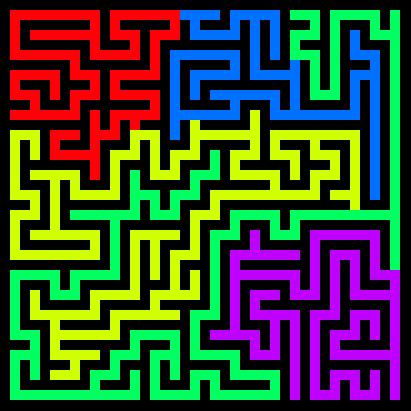

# Hive-Carving Algorithm（ハイヴ・カービング法）



穴掘り法を複数並列で動かし、別々のプロセスが掘った通路がぶつかった所で壁を 1 枚だけ開けて、**意図的にループを作る** 迷路生成アルゴリズムです。
ループを含むので、右手法・左手法では解けない迷路を作れます。

上の画像はオリジナルの HSP3 版で生成したものです（41×41、並列数 5）。

## 実装

| 言語 | ファイル |
| --- | --- |
| HSP3（オリジナル） | [`HSP3/Hive-Carving Algorithm.hsp`](HSP3/Hive-Carving%20Algorithm.hsp) |
| C++17（ヘッダオンリー） | [`C++/hive_carving.hpp`](C++/hive_carving.hpp) |
| C#（C# 7.3 以降。Unity でも使用可） | [`C#/HiveCarving.cs`](C%23/HiveCarving.cs) |
| Python 3.8 以降 | [`Python/hive_carving.py`](Python/hive_carving.py) |
| Rust | [`Rust/src/lib.rs`](Rust/src/lib.rs) |
| JavaScript（ESM、型定義付き） | [`JavaScript/hive-carving.js`](JavaScript/hive-carving.js) |
| Java 8 以降 | [`Java/HiveCarving.java`](Java/HiveCarving.java) |
| Go | [`Go/hivecarving.go`](Go/hivecarving.go) |

どの実装も外部ライブラリを使わず、迷路の生成だけを行います（描画はしません）。
どの言語でも、**同じシードからは同じ迷路** が生成されます。

## 使い方

引数はどの言語も `(width, height, parallel, seed)` です。

| 引数 | 内容 |
| --- | --- |
| `width`, `height` | マップサイズ。3 以上の奇数（既定値 41） |
| `parallel` | 並列で動かす穴掘りプロセスの数。1 以上（既定値 5）。部屋の数を超えた分は切り詰める |
| `seed` | 32 bit 符号なし整数。省略するとランダム |

生成結果は `width × height` のマップです。各マスの値は、`0` が壁、`1`～`parallel` がそのマスを掘ったプロセスの番号です。

```python
from hive_carving import HiveCarving

maze = HiveCarving(41, 41, 5, seed=12345)
maze.run()                     # 完了まで生成する
maze.cell(1, 1)                # マスの値（0 = 壁）
maze.is_wall(0, 0)             # True
maze.cells                     # マップ全体（インデックスは y * width + x）
```

`step()` を呼ぶと、全プロセスを 1 マスずつ進めます。生成が完了すると `True` を返します。
掘っていく過程を表示したい場合は、`step()` を呼ぶたびに描画してください。

| 言語 | 生成 | 1 ステップ | マスの値 / 壁判定 |
| --- | --- | --- | --- |
| C++ | `woodennut::generate(w, h, p, seed)` | `step()` | `cell(x, y)` / `is_wall(x, y)` |
| C# | `WoodenNut.HiveCarving.Generate(w, h, p, seed)` | `Step()` | `GetCell(x, y)` / `IsWall(x, y)` |
| Python | `generate(w, h, p, seed)` | `step()` | `cell(x, y)` / `is_wall(x, y)` |
| Rust | `hive_carving::generate(w, h, p, seed)?` | `step()` | `cell(x, y)` / `is_wall(x, y)` |
| JavaScript | `generate(w, h, p, seed)` | `step()` | `cell(x, y)` / `isWall(x, y)` |
| Java | `HiveCarving.generate(w, h, p, seed)` | `step()` | `getCell(x, y)` / `isWall(x, y)` |
| Go | `hivecarving.Generate(w, h, p, seed)` | `Step()` | `Cell(x, y)` / `IsWall(x, y)` |

ほかに、`seed`（使用したシード）、`parallel`（切り詰め後の並列数）、`rounds`（ステップ数）、`finished` も参照できます。

Go 版は `go get github.com/WoodenNut27/Hive-Carving-Algorithm/Go` で取得し、`import hivecarving "github.com/WoodenNut27/Hive-Carving-Algorithm/Go"` で取り込めます。

### サンプル

どの言語にも、迷路をテキストで出力するサンプルがあります。リポジトリ直下で実行します。

```sh
# 引数: [width] [height] [parallel] [seed] [text|ids]
g++ -std=c++17 -O2 -o example C++/example.cpp && ./example 41 41 5 12345   # MSVC: cl /std:c++17 /EHsc C++\example.cpp
dotnet run --project "C#/Example" -- 41 41 5 12345
python Python/example.py 41 41 5 12345
cargo run --release --manifest-path Rust/Cargo.toml --example example -- 41 41 5 12345
node JavaScript/example.js 41 41 5 12345
javac -encoding UTF-8 -d out Java/*.java && java -cp out Example 41 41 5 12345
cd Go && go run ./cmd/example 41 41 5 12345
```

5 番目の引数に `ids` を指定すると、マップを数値（プロセス番号）で出力します。

## アルゴリズム

x・y がともに奇数のマスを「部屋」、部屋と部屋の間のマスを「壁」として扱います。

1. 部屋の中から、重複しないように `parallel` 個のスタート位置を抽選して掘ります。
2. プロセス 1 から順に、各プロセスが次の処理を 1 回ずつ行います。
   1. `rnd(4)` で決めた方向から時計回り（左 → 上 → 右 → 下）に、2 マス先を調べます。
      - **壁** なら、その方向に決めて調べるのをやめます。
      - **まだ接続していない別のプロセスの通路** なら、間の壁を開けて接続し、残りの方向も調べ続けます。
   2. 方向が決まったら 2 マス掘って進み、その方向をスタックに積みます。
      決まらなければ、スタックから取り出した方向の逆へ 1 マス戻ります。スタックが空なら、その場にとどまります。
3. 全プロセスの処理が終わった時点で、すべての部屋が掘られていれば完了です。終わっていなければ 2 に戻ります。

各プロセスは自分の通路とはつながず、同じ相手とは 1 か所でしかつながりません。そのため、ループができるのは 3 つ以上のプロセスが輪になってつながったときです。
`parallel` が 1 または 2 の場合、ループのない完全迷路になります。
3 以上でも、プロセス同士が輪になってつながらなければ、ループのない迷路になることがあります。

## 乱数

言語間で同じ結果を得るため、全実装で同じ乱数（Mulberry32）を使っています。演算はすべて 32 bit 符号なし整数で行います。

```text
next():  state += 0x6D2B79F5
         t = (state ^ (state >> 15)) * (state | 1)
         t = (t + (t ^ (t >> 7)) * (t | 61)) ^ t
         return t ^ (t >> 14)
rnd(n) = next() % n
```

`state` の初期値はシードです。乱数を使う順番は次のとおりです。

1. スタート位置の抽選：部分的な Fisher-Yates シャッフルで、`rnd(部屋の数 - i)` を `parallel` 回
2. 各ステップの方向決め：`rnd(4)` をプロセスごとに 1 回。もう掘れないプロセスも毎回引く

新しい言語に移植するときも、この順番を守れば同じ迷路になります。

## HSP3 オリジナルとの違い

方向の調べ方、接続の仕方、戻り方、完了判定のタイミングなど、メインループの動作はオリジナルと同じです。違うのは次の点です。

- 乱数を Mulberry32 に変えました。
- スタート位置の決め方を「ランダムに選び、使用済みなら選び直す」方式から、重複なしの抽選に変えました。部屋の選ばれ方は変わりません。
- 接続済みのプロセスの組を、`parallel × parallel` の配列ではなくハッシュセットで管理しています。並列数を増やしてもメモリが膨らみません。

## テスト

```sh
node tests/run_all.mjs
```

各実装のサンプルを 15 通りの条件で実行し、出力したマップが HSP3 オリジナルと完全に一致するかを確かめます。
比較に使う HSP3 版は [`tests/hsp3_reference.hsp`](tests/hsp3_reference.hsp) です。これはオリジナルのメインループをそのまま使い、乱数とスタート位置の決め方だけを差し替えたものです。

HSP3 が無い環境では、JavaScript 版を基準にします。ツールチェーンが見つからない言語はスキップします。
ツールが PATH に無い場合は、環境変数 `HSP3_ROOT`（既定値 `C:\hsp37`）、`JAVA_HOME`、`PYTHON` で場所を指定できます。

## ライセンス

[NYSL Version 0.9982](LICENSE)（[NYSL について](https://www.kmonos.net/nysl/)）

作者：木製ナット（WoodenNut） — https://www.woodennut.com/
